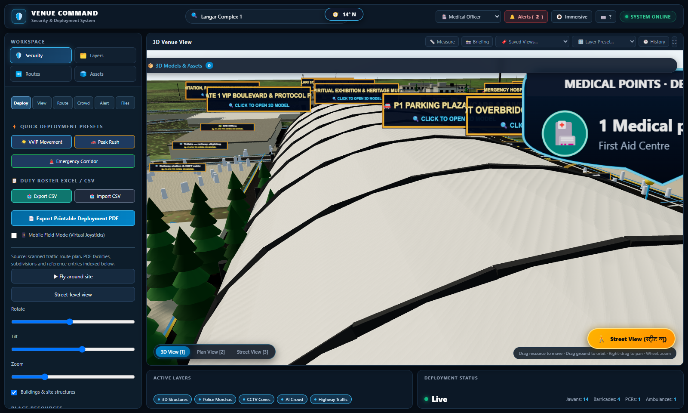

# 🛡️ VENUE COMMAND — 3D Security, Deployment & Digital Twin System
### 78th Annual Nirankari Sant Samagam · Samalkha, Haryana

An interactive, browser-native 3D C4I Security Operations & Venue Command Digital Twin built with **React 18 + TypeScript + Three.js + React Three Fiber + GSAP**.



---

## ⚡ Quick Start (Run Locally)

The entire system is completely self-contained with offline WebGL support:

```bash
# Clone the repository
git clone https://github.com/kapilk14031-svg/3D-Model-sant.git
cd 3D-Model-sant

# Start any local HTTP server
python -m http.server 8080
# OR
npx serve .
```

Open your browser to:
👉 `http://localhost:8080/outputs/e-bandobast-react.html`  
(or open `outputs/e-bandobast-react.html` directly in any WebGL-capable browser).

---

## 🚀 Key Features

### 1. 👮 Smart E-Bandobast & Duty Allocation
- **Duty Point Roster Integration**: Interactive morcha/checkpoint cards displaying stationed officer name, rank, contact number (`tel:` link), shift timing, and reporting DSP.
- **Excel / CSV Import & Export**: 1-click import and export of operational duty rosters.
- **Quick Deployment Presets**:
  - 🌟 **VVIP Movement**: VIP Gate 1 sanitization cordon, Stage security, escort PCRs, ALS cardiac ambulance.
  - 🚗 **Peak Evening Rush**: Heavy crowd barricades at Gates 1, 2, 3, FOB crossings, and Langar queue funnels.
  - 🚨 **Emergency Green Corridor**: Cleared arterial path to Civil Hospital ICU with automated dynamic barricade preemption.
- **Line-of-Sight & CCTV Coverage Cones**: 3D frustum cones from surveillance masts and watchtowers visualizing blind spots.

### 2. 🧭 Turn-by-Turn Wayfinding & Pathfinding
- **Shortest Path Route Engine**: Connects 25+ key Samagam landmarks (Gates, Parking sectors, Satsang Pandal, Langar halls, ICU Hospital, Railway terminal).
- **Glowing Animated 3D Road Path**: Animated pulsing 3D spline ribbons with start/finish beacons.
- **Distance & Time Estimates**: Real-time metric walking distances and estimated transit times.

### 3. 👥 Microscopic Crowd Dynamics & Evacuation Science
- **Pedestrian Agent Swarm**: Hundreds of autonomous devotee agents navigating arterial paths with collision avoidance.
- **Stampede & Bottleneck Prediction**: Real-time density monitoring at critical pinch-points (FOB 1/2, Gate 1/2, Pandal exits). Triggers pulsating red warnings and alerts when density exceeds $4.0\text{ people/m}^2$.
- **Hydraulic Egress Counter**: 1-click disaster simulation calculating mass evacuation drain times from Pandal to open assembly grounds.

### 4. 🚑 Automated Emergency Response & Green Corridor
- **Golden-Hour Dispatch**: Automated shortest non-conflicting path calculation from any incident location to Trauma ICU.
- **Dynamic Barricade Preemption**: 3D emergency ambulance with flashing LED strobes drives the route while intermediate virtual barricades **automatically swing open 90°** within 35 meters.
- **Fire Hose Reach Rings**: 30m direct high-pressure hose stream and 60m booster relay coverage circles around water points.

### 5. 📱 Mobile Field Mode & Operator Usability
- **Touch-Friendly Dual Virtual Joysticks**: Left thumb walk/strafe and right thumb orbit/look controls for mobile devices and tablets.
- **Live Compass**: Floating HUD compass showing real-time azimuth bearing in degrees.
- **Global Search (<kbd>Ctrl+K</kbd> / <kbd>/</kbd>)**: Instant autofocus and camera jump to any gate, facility, or morcha.
- **Saved Camera Views**: 1-click orientation presets (Overview, Pandal, Gate 1 VIP, Langar, Hospital, Transit).
- **Measurement Tool (<kbd>M</kbd>)**: Distance and area measuring tape.
- **Change History Audit Trail**: Comprehensive logging of operator actions.
- **Printable Deployment PDF**: Official formatted report generator with resource counts and signature blocks.

---

## 📂 Deliverables & Repository Structure

```
├── outputs/
│   ├── e-bandobast-react.html        # Production standalone WebGL React viewer
│   ├── e-bandobast-3d.html           # Offline viewer bundle
│   ├── e-bandobast-scene.glb         # Full 3D venue scene (22.2 MB GLB)
│   ├── e-bandobast-model.obj         # 3D model in OBJ format (20.2 MB)
│   ├── pandal-hall-concept.glb       # Mega-pandal structural concept (6.1 MB)
│   ├── e-bandobast-react-source.zip  # Source delivery archive
│   └── pdf-landmark-register.json    # Landmark catalog & coordinate register
├── work/
│   ├── r3f-build/                    # Active React/Three.js TypeScript workspace
│   │   ├── src/
│   │   │   ├── advancedBandobast.ts  # C4I security, wayfinding & simulation module
│   │   │   ├── venue.js              # Procedural venue & 3D world engine
│   │   │   ├── facilityModels.ts     # Procedural 3D landmark architectural models
│   │   │   ├── bigPandal.ts          # Satsang hall interior & audience seating
│   │   │   ├── streetView.ts         # First-person 360° ground walkthrough
│   │   │   ├── deployment.ts         # Deployment items & zone management
│   │   │   ├── plan.ts               # Deployment data schemas
│   │   │   └── main.tsx              # React Three Fiber root
│   │   ├── template.html             # Command Center UI template
│   │   ├── build.cjs                 # esbuild bundler
│   │   └── package.json
│   ├── assemble-react.py             # Packaging script
│   └── test_*.cjs                    # Playwright verification test suites
└── README.md
```

---

## 🛠️ Build from Source

```bash
cd work/r3f-build
npm install
npm run build
python ../assemble-react.py
```

---

## 📜 License & Acknowledgements
- Developed for the **78th Annual Nirankari Sant Samagam Security & Bandobast Operations**.
- Built with Three.js, React Three Fiber, GSAP, and esbuild.
